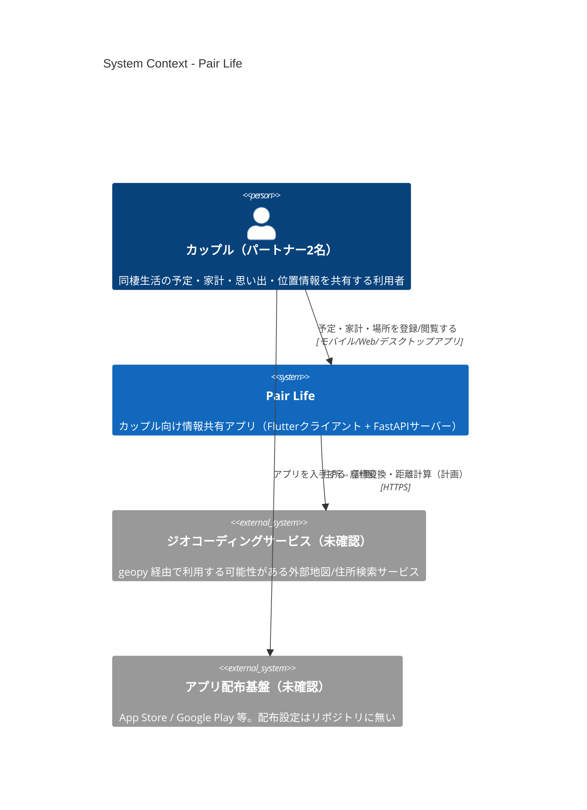

## アーキテクチャ概要

Pair Life の全体像（C4モデル Level 1: System Context）です。Container / Component 図やデータフロー、未実装・未確認事項の詳細は [docs/architecture.md](docs/architecture.md) を参照してください。

> 注: 現状、Flutter クライアントと FastAPI サーバーはまだ接続されておらず、サーバーの `database` / `models` / `routers` モジュールは未コミットです。

---

# pair_life
## 概要
pair_lifeは、カップルの同棲生活をサポートするための情報共有アプリです。
Flutter（フロントエンド）とFastAPI（バックエンド）を用いて構築されています。

## 主な機能
- カレンダー機能：予定や記念日を共有
- 交際日数計算機能：付き合った日からの日数を表示
- 家計簿機能：共同の支出・収入を管理
- 行った場所の記録機能：思い出の場所を保存
- 位置情報共有機能：お互いの現在地を確認

## システム構成
- クライアント側：Flutter（Android/iOS対応）
- サーバー側：FastAPI（Python）
- データベース：PostgreSQL

## 開発環境のセットアップ
### クライアント側（Flutter）
1. Flutter SDKのインストール
2. 依存関係のインストール: `flutter pub get`
3. アプリの実行: `flutter run`

### サーバー側（FastAPI）
1. Python 3.8以上のインストール
2. 仮想環境の作成: `python -m venv venv`
3. 仮想環境の有効化: `. venv/bin/activate` (Unix) または `venv\Scripts\activate` (Windows)
4. 依存関係のインストール: `pip install -r requirements.txt`
5. サーバーの起動: `uvicorn main:app --reload`
