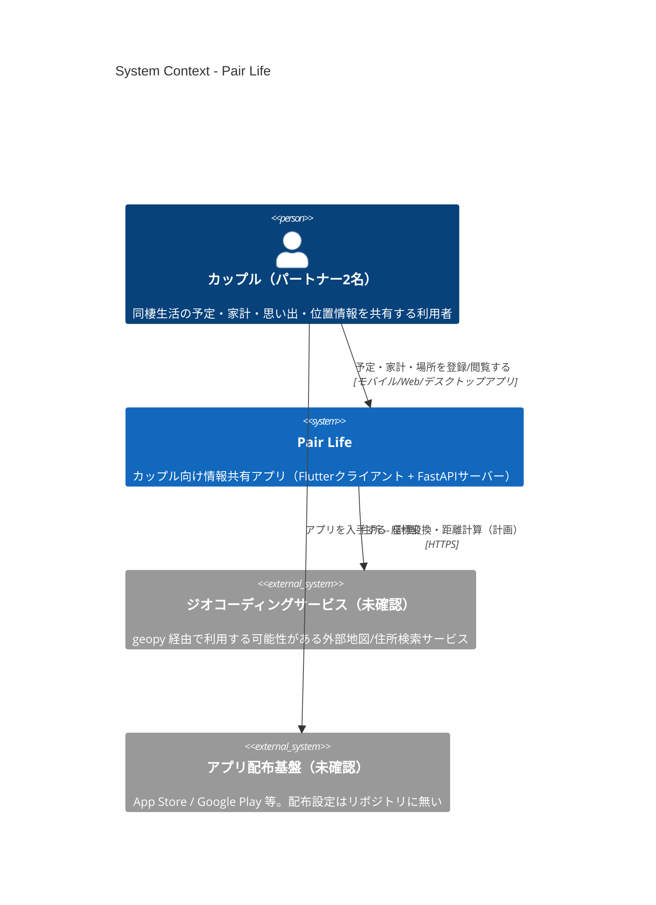
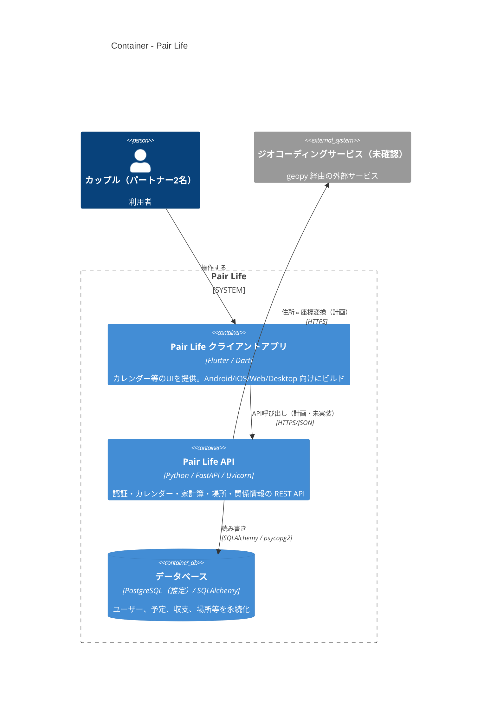
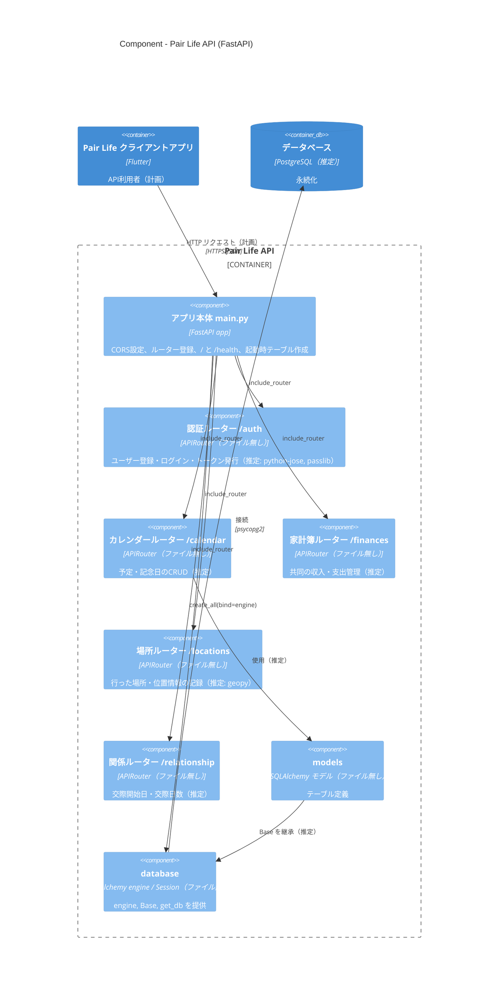
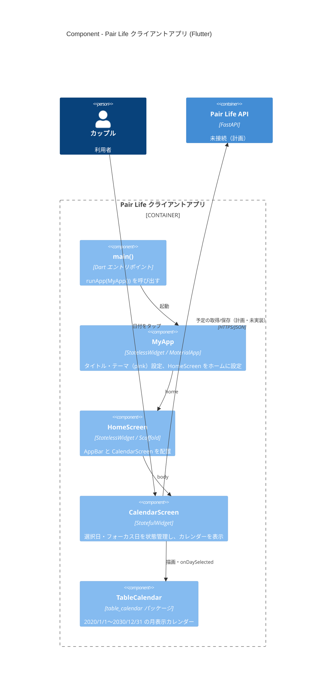
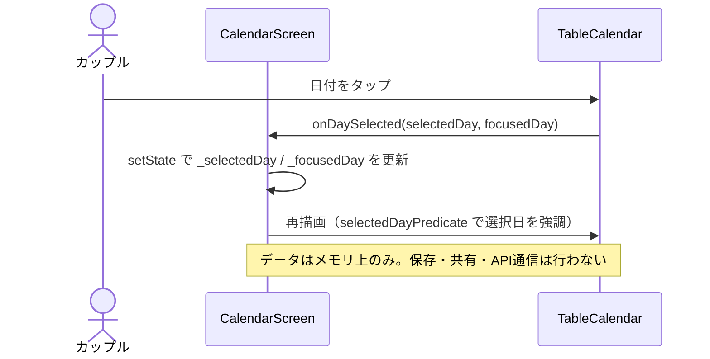
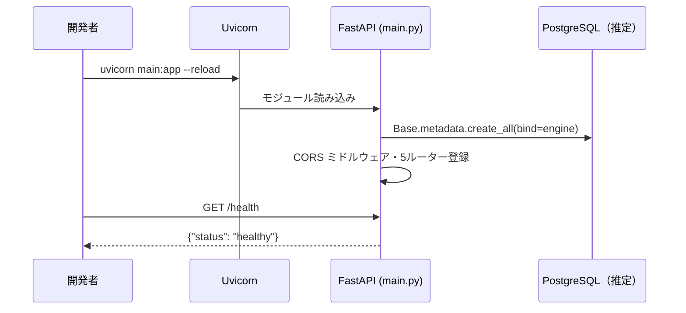
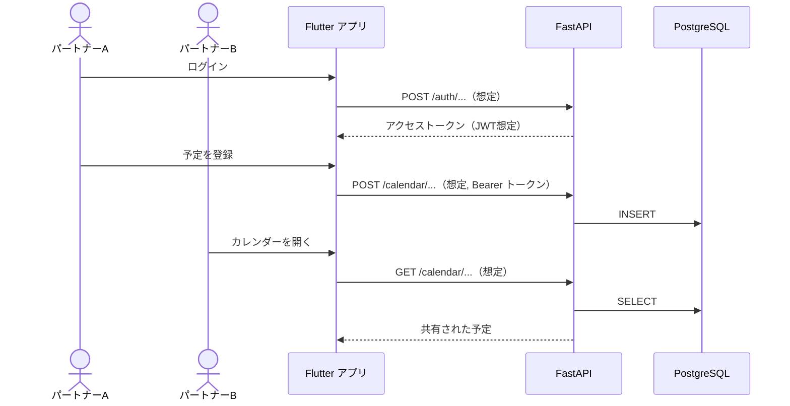

# Pair Life アーキテクチャ（C4モデル）

本ドキュメントは、リポジトリ内のコード・設定ファイルを調査した結果に基づき、Pair Life の構成を [C4モデル](https://c4model.com/) で整理したものです。
コードから確認できない事項は **「未確認」**、README 等に記載はあるが実装が見当たらない事項は **「計画（未実装）」** と明記しています。

> 調査時点のコミット: `6b3e322 FirstCommit!`

## 1. 概要

### アプリの目的

カップルの同棲生活をサポートする情報共有アプリ（`README.md` より）。README に記載された予定機能は以下のとおりです。

| 機能 | 実装状況（コード上） |
|---|---|
| カレンダー（予定・記念日の共有） | クライアントにカレンダー表示UIのみ実装（`pair_life/lib/main.dart`）。予定の保存・共有は未実装 |
| 交際日数計算 | 計画（未実装）。サーバーに `/relationship` ルーター登録のみ |
| 家計簿 | 計画（未実装）。サーバーに `/finances` ルーター登録のみ |
| 行った場所の記録 | 計画（未実装）。サーバーに `/locations` ルーター登録のみ |
| 位置情報共有 | 計画（未実装）。位置情報パーミッション等の設定も無し |

### 主な利用者

- **カップル（パートナー2名）** — 同じデータを共有して利用するエンドユーザー

### 技術スタック

| 区分 | 技術 | 根拠 |
|---|---|---|
| クライアント | Flutter / Dart（SDK `^3.7.2`）, Material Design | `pair_life/pubspec.yaml` |
| クライアント依存 | `table_calendar ^3.0.9`, `cupertino_icons` | `pair_life/pubspec.yaml` |
| 対象プラットフォーム | Android / iOS / Web / macOS / Windows / Linux（Flutter 標準ランナー） | `pair_life/android` ほか各ディレクトリ |
| APIサーバー | Python, FastAPI, Uvicorn | `server/main.py`, `server/requirements.txt` |
| ORM / マイグレーション | SQLAlchemy 2.x, Alembic（Alembic 設定ファイルは未確認） | `server/requirements.txt` |
| データベース | PostgreSQL（`psycopg2-binary` と README 記載から推定。接続設定は未確認） | `README.md`, `server/requirements.txt` |
| 認証 | JWT（`python-jose`）＋パスワードハッシュ（`passlib`）と推定。実装は未確認 | `server/requirements.txt` |
| 設定 | `python-dotenv`（`.env` 読み込みと推定。`.env` 例は無し） | `server/requirements.txt` |
| 位置情報 | `geopy`（ジオコーディング/距離計算用と推定。利用先の外部ジオコーディングサービスは未確認） | `server/requirements.txt` |
| インフラ / IaC / Docker / CI | なし（Dockerfile, docker-compose, Terraform, GitHub Actions 等は存在しない） | リポジトリ全体 |

### 現状に関する重要な注記

- `server/main.py` は `database`（`engine`, `Base`, `get_db`）、`models`、`routers`（`auth`, `calendar`, `finances`, `locations`, `relationship`）を import していますが、**これらのモジュールはリポジトリに存在しません**。そのため現状のサーバーはそのままでは起動できません。
- Flutter クライアントには HTTP クライアント（`http` / `dio` 等）の依存も API 呼び出しコードも無く、**クライアントとサーバーはまだ接続されていません**。下記の図ではクライアント→API の関係を「計画」として示しています。
- `pair_life/test/widget_test.dart` は Flutter テンプレートのカウンターテストのままで、現在の `main.dart` とは一致しません。

---

## 2. Level 1: System Context 図



| 名前 | 種別 | 技術 | 責務 |
|---|---|---|---|
| カップル（パートナー2名） | Person | — | アプリを利用し、2人の生活情報を登録・共有する |
| Pair Life | Software System（本システム） | Flutter, FastAPI, PostgreSQL | カレンダー、交際日数、家計簿、場所記録、位置情報共有を提供する |
| ジオコーディングサービス | External System（未確認） | geopy が対応する各種サービス | 住所と座標の変換。`geopy` が依存にあるのみで、具体的なサービス・利用コードは未確認 |
| アプリ配布基盤 | External System（未確認） | App Store / Google Play 等 | アプリの配布。`applicationId` は `com.example.pair_life` のテンプレート値のままで、配布設定は未確認 |

---

## 3. Level 2: Container 図



| 名前 | 種別 | 技術 | 責務 |
|---|---|---|---|
| Pair Life クライアントアプリ | Container（モバイル/Web/デスクトップアプリ） | Flutter, Dart, `table_calendar` | UI を提供する。現状はカレンダー表示のみで、API 通信・ローカル保存は未実装 |
| Pair Life API | Container（APIサーバー） | FastAPI, Uvicorn, SQLAlchemy, Pydantic | REST API を提供し、起動時に `Base.metadata.create_all` でテーブルを作成する。CORS は全オリジン許可。`/`、`/health` のみ `main.py` で定義済み |
| データベース | Container（DB） | PostgreSQL（推定） | アプリデータを永続化する。接続文字列・スキーマ定義（`database.py`, `models.py`）はリポジトリに無く未確認 |
| ジオコーディングサービス | External System（未確認） | — | `geopy` 経由の住所/座標変換 |

**存在しないコンテナ**: ファイルストレージ、バッチ/ワーカー、メッセージキュー、プッシュ通知、外部認証（Firebase 等）の設定・依存はリポジトリに見当たりません。

---

## 4. Level 3: Component 図

### 4.1 Pair Life API（FastAPI）

`server/main.py` に登録されているルーター・モジュールを基に記述しています。`main.py` 以外のファイルは **リポジトリに存在しない** ため、各コンポーネントの責務はルーター名・タグ・依存ライブラリからの推定です。



| 名前 | 種別 | 技術 | 責務 |
|---|---|---|---|
| アプリ本体 `main.py` | Component（実在） | FastAPI | アプリ生成、CORS（全許可）、5つのルーター登録、`GET /`・`GET /health`、起動時のテーブル作成 |
| 認証ルーター `/auth` | Component（ファイル無し） | APIRouter | 認証 API（推定）。`routers/auth.py` は未確認 |
| カレンダールーター `/calendar` | Component（ファイル無し） | APIRouter | 予定 API（推定）。`routers/calendar.py` は未確認 |
| 家計簿ルーター `/finances` | Component（ファイル無し） | APIRouter | 家計簿 API（推定）。`routers/finances.py` は未確認 |
| 場所ルーター `/locations` | Component（ファイル無し） | APIRouter | 場所・位置情報 API（推定）。`routers/locations.py` は未確認 |
| 関係ルーター `/relationship` | Component（ファイル無し） | APIRouter | 交際情報 API（推定）。`routers/relationship.py` は未確認 |
| `models` | Component（ファイル無し） | SQLAlchemy | ORM モデル定義。`models.py` は未確認 |
| `database` | Component（ファイル無し） | SQLAlchemy | `engine`・`Base`・`get_db`（DBセッション依存性）を提供。`database.py` は未確認 |

### 4.2 Pair Life クライアントアプリ（Flutter）

`pair_life/lib/main.dart` の実装に基づきます（このファイルが Dart コードのすべてです）。



| 名前 | 種別 | 技術 | 責務 |
|---|---|---|---|
| `main()` | Component | Dart | アプリのエントリポイント |
| `MyApp` | Component | `MaterialApp` | アプリ全体のテーマ・ルート画面設定（ルーティングは無し） |
| `HomeScreen` | Component | `Scaffold` | ホーム画面の枠組み |
| `CalendarScreen` | Component | `StatefulWidget` | 選択日の状態を保持（メモリ上のみ、永続化・共有なし） |
| `TableCalendar` | Component（外部パッケージ） | `table_calendar` | カレンダーUIの描画 |

**未実装/存在しないもの**: 状態管理ライブラリ（Provider/Riverpod 等）、HTTP クライアント、ローカルDB、認証画面、家計簿・場所・位置情報画面。

---

## 5. 主要なデータフロー

### 5.1 カレンダーで日付を選択する（実装済み・クライアント内で完結）



### 5.2 API サーバー起動とヘルスチェック（`main.py` に実装済み。ただし依存モジュール欠落のため現状は起動不可）



### 5.3 予定を共有する（計画・未実装。README の機能説明とルーター構成からの想定）



> 5.3 のエンドポイントパスの詳細・認証方式はコード上未確認です（ルーターのプレフィックスのみ確認済み）。

---

## 6. ディレクトリ構成

```text
pair_life/                      # リポジトリルート
├── README.md                   # プロジェクト概要・機能一覧・セットアップ手順
├── LICENSE                     # MIT License
├── .gitignore                  # Flutter/Dart/各プラットフォーム向けの除外設定
├── docs/
│   └── architecture.md         # 本ドキュメント
├── server/                     # バックエンド（FastAPI）
│   ├── main.py                 # API エントリポイント（ルーター登録・CORS・ヘルスチェック）
│   └── requirements.txt        # Python 依存定義
│   # ※ main.py が参照する database.py / models.py / routers/ は未コミット
└── pair_life/                  # フロントエンド（Flutter プロジェクト）
    ├── pubspec.yaml            # Dart/Flutter 依存定義
    ├── analysis_options.yaml   # Lint 設定（flutter_lints）
    ├── lib/main.dart           # アプリ本体（MyApp / HomeScreen / CalendarScreen）
    ├── test/widget_test.dart   # ウィジェットテスト（テンプレートのまま）
    ├── android/                # Android ランナー（Kotlin, Gradle KTS）
    ├── ios/                    # iOS ランナー（Swift, Xcode）
    ├── macos/                  # macOS ランナー
    ├── windows/                # Windows ランナー（C++/CMake）
    ├── linux/                  # Linux ランナー（C++/CMake/GTK）
    └── web/                    # Web 用 index.html / manifest / アイコン
```

| ディレクトリ | 役割 |
|---|---|
| `server/` | FastAPI による REST API サーバー。現状は `main.py` と依存定義のみ |
| `pair_life/lib/` | Flutter アプリの Dart ソースコード |
| `pair_life/test/` | Flutter のテスト |
| `pair_life/android`, `ios`, `macos`, `windows`, `linux`, `web` | 各プラットフォーム向けのネイティブランナー/ビルド設定（Flutter テンプレート生成物） |
| `docs/` | 設計ドキュメント |

## 7. 未確認事項まとめ

- `server/database.py`, `server/models.py`, `server/routers/*.py` の内容（リポジトリに存在しない）
- DB 接続先・接続文字列・環境変数（`.env` や設定例が無い）
- 認証方式の詳細（JWT の発行/検証ロジック、トークン有効期限など）
- geopy で利用する外部ジオコーディングサービス
- デプロイ先・ホスティング・CI/CD（Docker / IaC / ワークフロー定義が無い）
- アプリの配布設定（`applicationId` はテンプレート値 `com.example.pair_life`）
